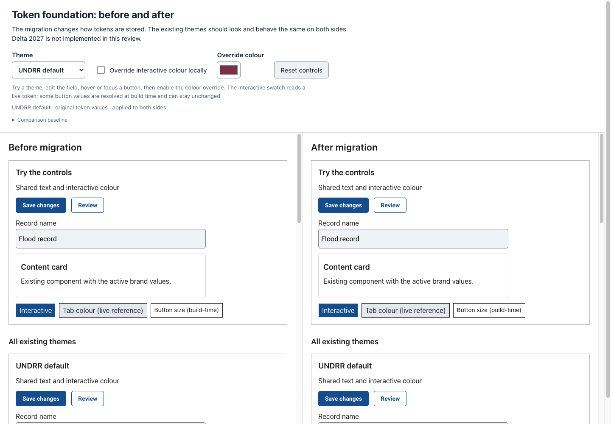
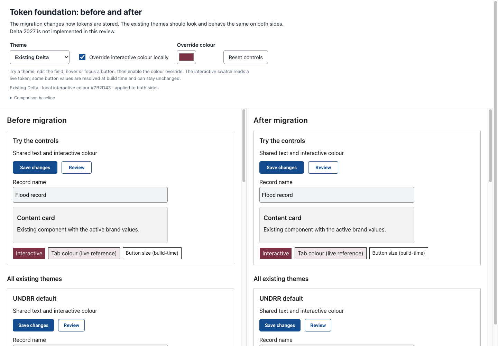

# Try the token foundation locally

The migration changes the source format. Existing themes should look and behave the same before and after it. Delta 2027 is a separate follow-up and is not shown here.

## Running review pages

- [Before/after comparison](http://127.0.0.1:6127/index.html): use the Theme dropdown, edit the field, hover or focus the buttons, then enable the local colour override. Both panes should respond identically. Reset restores the default view. Scroll inside either pane for the five existing themes.
- [Storybook: button variants](http://127.0.0.1:6099/?path=/story/components-buttons-buttons--all-variants): use the toolbar's **Global theme for components** menu to try UNDRR, PreventionWeb, IRP, MCR2030 and DELTA Resilience.
- [Storybook: text inputs](http://127.0.0.1:6099/?path=/story/components-forms-text-input--default): type in the field, then inspect the error and disabled stories in the sidebar.
- [Storybook: cards](http://127.0.0.1:6099/?path=/story/components-cards-vertical-card--default-vertical-card): compare the theme treatments on an existing content component.

These are local servers on the reviewer's computer. The URLs are not hosted previews.

The colour override illustrates a live token relationship. Some button values resolve at build time and can stay unchanged while the interactive swatch and tab colour update. Matching behaviour on both sides is the intended result.

## Screenshots

Default values, before and after:



Existing Delta with a local interactive-colour override applied to both sides:



Screenshots were captured from the live local review at 1440 × 1000. They show existing-theme preservation and one runtime override, not approval of the future Delta 2027 design.

## Reproduce from a checkout

Install dependencies and build Storybook:

```sh
yarn install --immutable
yarn build
yarn serve-storybook
```

In a second terminal, generate the comparison from the recorded pre-migration commit and serve it:

```sh
node scripts/create-token-review.mjs --baseline-ref adae1531513c806456e8fd69c581188ac9114bcd
node scripts/serve-storybook.mjs .cache/token-review 6127
```

The comparison compiles both revisions with the installed Sass version. The baseline commit must exist in the local Git history; a shallow checkout may need to fetch the base branch first. The page displays the baseline hash for inspection.

For the scope and limits of the earlier verification, see [the validation record](DTCG-MIGRATION-VALIDATION.md).
