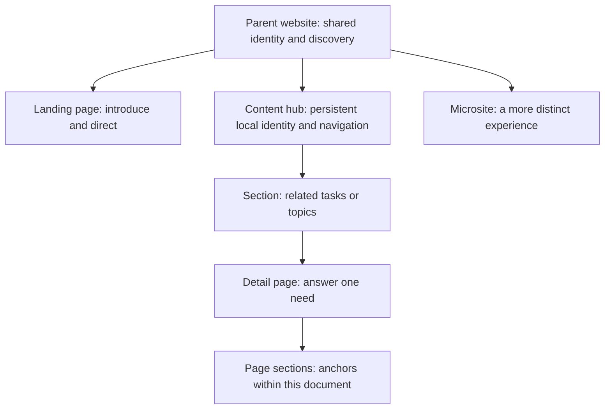

# Content hubs: an information architecture sketch

Working proposal, 9 September 2026. This describes a content experience; it does not prescribe Drupal configuration, publishing permissions, or a new content type.

[Tracker #1112](https://github.com/unisdr/undrr-mangrove/issues/1112) · [Editable SVG sketch](../../stories/assets/patterns/content-hub-layers.svg)


The interactive prototype currently uses simplified parent utilities and scrolling section links. Search, language, a wider-site menu, a section rail and a mobile Sections disclosure appear in the sketches as treatments to compare, not as completed features.

## The missing experience

UNDRR and PreventionWeb already offer a parent website and bespoke microsites. The gap is a recognisable group of related pages that people can explore sideways without returning to its landing page after every visit.

Call this a **content hub** in Mangrove. Visitors see its actual name, such as “Sendai Framework Monitor”, rather than the generic word “hub”. A hub may represent a topic, programme, collection, or guidance resource. It earns persistent navigation when users repeatedly move between its sections, rather than merely because its owner has several pages.

Separate two decisions:

| Experience decision | Delivery decision |
| --- | --- |
| How closely does this belong to the parent site's identity? | Does it use the existing Drupal site or a separate build? |
| Does it need sustained lateral navigation? | Who supplies its pages and navigation data? |
| Is it an editorial resource or a transactional tool? | Does it require application state or service integrations? |

A microsite can be static or CMS-backed. A content hub can be rendered by Drupal or static HTML. A full website is not inherently more usable or more flexible in its information architecture. The current microsite tooling may carry more implementation overhead, but that is not the definition of a microsite.



These are patterns, not a mandatory tree: an ordinary landing page can point to content across the site; a hub can link to a separately hosted tool without absorbing that tool's interface.

## Give each navigation layer one job

| Layer | User question | Proposed treatment |
| --- | --- | --- |
| Parent website | Whose site is this? Where is the wider site? | Existing brand, search and language access; a clear route to wider navigation |
| Hub | What resource am I using? What can I do here? | Stable linked hub name and a short set of section links |
| Ancestry | Where does this page belong? | A quiet breadcrumb trail, where it adds useful context |
| Section | What other guidance belongs with this page? | Scoped sibling links for deeper groups; avoid repeating the complete hub menu |
| Page | Where is the relevant passage? | Optional “On this page” links for genuinely long pages |

The layers need not all appear as horizontal bars. Use one visually dominant local navigation region, then choose the minimum additional aids the page needs. Do not make every layer sticky.

## Page sketches

### Basic landing page

```text
Parent identity + normal global navigation
Breadcrumbs

Page title
Brief introduction

Priority routes / featured content
Grouped links or cards
```

No persistent local navigation by default. A landing page introduces and distributes content; it need not establish another navigational territory.

### Hub home

```text
Parent identity                         Search  Language  Site menu
Sendai Framework Monitor
Overview   About   Indicators   Reporting   Reports   Data
━━━━━━━━━━

Introduction: what this resource helps you do
[Understand progress]  [Prepare a report]  [Explore the data]
Supporting guidance / recent changes / contacts
```

The title and section labels remain recognisable on every hub page. The home page can be more expressive, but its large introductory content should not repeat on detail pages.

### Hub detail

```text
Parent identity                         Search  Language  Site menu
Sendai Framework Monitor
Overview   About   Indicators   Reporting   Reports   Data
                               ━━━━━━━━━
Home / Sendai Framework / Monitor / Reporting / How to report

How to report                            On this page
Introduction                             Reporting cycle
                                         Data validation
Main content                             Focal points
```

“Reporting” remains visibly active on descendants. It is a page link, not a tab-panel control. Its active-ancestor state must not falsely claim that its destination is the current page. Breadcrumb placement should be tested against the supplied mockup; the purpose matters more than fixing this ordering prematurely.

### Deep section

```text
Same parent identity and hub navigation
Breadcrumbs

Reporting guidance              How to report
  Getting started               Introduction
  How to report  ← current      Optional compact page contents
  Validate data                 Main content
  Submit a report
```

A left rail is still a reasonable option for a dense reference section. It should be justified by navigation need, not rejected for looking unfashionable. If this page uses a section rail, keep in-page contents compact in the article rather than adding a second full side rail. For shallow sections, a short “More in Reporting” list can be sufficient.

### Mobile

```text
Parent identity           Site menu
Sendai Framework Monitor
Reporting                  Sections ▾

Monitor / Reporting
How to report
[On this page ▾]    only for long content
Main content
```

An explicit “Sections” disclosure provides a legible overview when labels are long. A scrollable link strip is a useful alternative to test for a small, flat menu and visual continuity with Mangrove's refreshed tabs. Do not assume horizontal scrolling is always the best mobile navigation. Keep the selected section discoverable, preserve ordinary link behaviour and keyboard access, and test Arabic and long translated names. Avoid two indistinguishable hamburger controls.

## What to build and compare

Start with additive Storybook patterns: basic landing page, hub home, hub detail, and deep section. Compose existing components. A small hub identity/navigation component is plausible; an all-purpose website shell with many configuration flags is premature.

Prototype two parent-header compositions explicitly:

- **Standard parent navigation:** demonstrates the navigation density honestly and provides the safer familiar baseline.
- **Focused hub navigation:** retains parent identity and an explicit wider-site menu while giving local navigation prominence.

The second is a design hypothesis. It should not silently remove existing site navigation or become the default for all pages in a new component.

Keep shared content in its canonical location. Linking a report from several hubs should not require creating multiple report pages. Entering from search must still explain the hub and active section; the experience cannot depend on having visited its home first. A tool such as a reporting application may need its own task-oriented navigation rather than inheriting every editorial hub link.

## Questions worth testing before choosing a default

1. Can a first-time visitor identify the resource and move to a sibling section without returning home?
2. Do repeat users understand the difference between the parent site's search/menu and the hub's links?
3. Does a deep page need sibling navigation often enough to justify a rail or disclosure?
4. Can the longest translated labels fit without making content difficult to reach?
5. Does the focused parent header improve orientation, or make people feel they have unexpectedly left the website?
6. When users move from guidance into a tool, is the transition clear and the return route useful?

## Reference lessons

GOV.UK deliberately separates the parent brand and global tools from service identity and navigation. Its guidance also treats navigation as selected routes rather than an exhaustive site map. This is a useful analogy for a hub, not evidence that Mangrove must copy a transactional service header. [Navigate a service](https://design-system.service.gov.uk/patterns/navigate-a-service/)

GOV.UK distinguishes the exact current page from a link whose group contains the current page. That distinction maps directly to keeping Reporting active on “How to report”. [Service navigation](https://design-system.service.gov.uk/components/service-navigation/)

Multiple navigation landmarks should have distinct labels when they serve different purposes. Breadcrumbs provide an ancestry route; they are one navigation aid rather than a substitute for lateral links. [W3C navigation landmarks](https://www.w3.org/WAI/ARIA/apg/patterns/landmarks/examples/navigation.html), [W3C multiple ways](https://www.w3.org/WAI/tutorials/menus/multiple-ways/)
