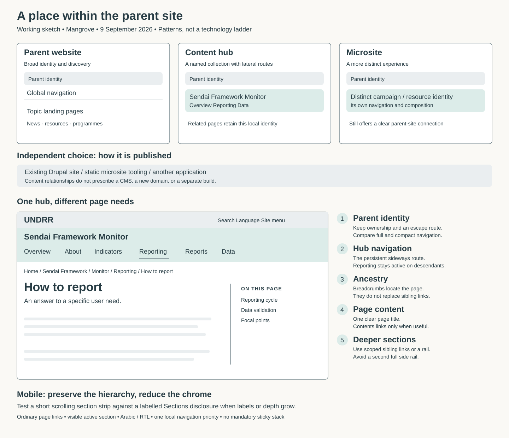
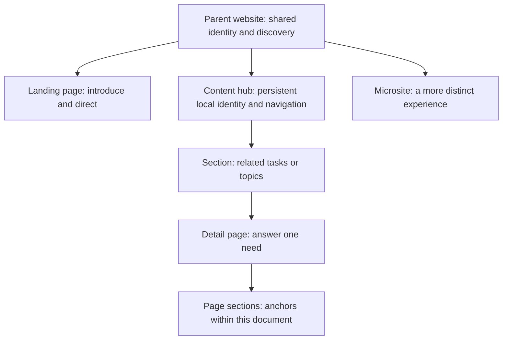

# Content hubs: an information architecture sketch

Working proposal, 9 September 2026. This describes a content experience; it does not prescribe Drupal configuration, publishing permissions, or a new content type.

[Tracker #1112](https://github.com/unisdr/undrr-mangrove/issues/1112) · [Editable SVG sketch](../../stories/assets/patterns/content-hub-layers.svg)



The interactive prototype now renders the standard UNDRR page header and mega menu above the hub, so the local navigation is judged against the real parent chrome. A section rail and a mobile Sections disclosure appear in the sketches as treatments to compare, not as completed features.

## The missing experience

UNDRR and PreventionWeb already offer a parent website and bespoke microsites. The gap is a recognisable group of related pages that people can explore sideways without returning to its landing page after every visit.

Call this a **content hub** in Mangrove. Visitors see its actual name, such as “Sendai Framework Monitor”, rather than the generic word “hub”. A hub may represent a topic, programme, collection, or guidance resource. It earns persistent navigation when users repeatedly move between its sections, rather than merely because its owner has several pages.

Separate two decisions:

| Experience decision | Delivery decision |
| --- | --- |
| How closely does this belong to the parent site's identity? | Does it use the existing Drupal site or a separate build? |
| Does it need sustained lateral navigation? | Who supplies its pages and navigation data? |
| Is it an editorial resource or a transactional tool? | Does it require application state or service integrations? |

A microsite can be static or CMS-backed. A content hub can be rendered by Drupal or static HTML. A full website is not inherently more usable or more flexible in its information architecture. The current microsite tooling may carry more implementation overhead, but that is not the definition of a microsite.



These are patterns, not a mandatory tree: an ordinary landing page can point to content across the site; a hub can link to a separately hosted tool without absorbing that tool's interface.

## Give each navigation layer one job

| Layer | User question | Proposed treatment |
| --- | --- | --- |
| Parent website | Whose site is this? Where is the wider site? | Existing brand, search and language access; a clear route to wider navigation |
| Hub | What resource am I using? What can I do here? | Stable linked hub name and a short set of section links |
| Ancestry | Where does this page belong? | A quiet breadcrumb trail, only where it adds an ancestor the hub navigation cannot show |
| Section | What other guidance belongs with this page? | Scoped sibling links for deeper groups; avoid repeating the complete hub menu |
| Page | Where is the relevant passage? | Optional “On this page” links for genuinely long pages |

The layers need not all appear as horizontal bars. Use one visually dominant local navigation region, then choose the minimum additional aids the page needs. Do not make every layer sticky.

## Page sketches

### Basic landing page

```text
Parent identity + normal global navigation
Breadcrumbs

Page title
Brief introduction

Priority routes / featured content
Grouped links or cards
```

No persistent local navigation by default. A landing page introduces and distributes content; it need not establish another navigational territory.

### Hub home

```text
UNDRR brand bar                                   Language
UNDRR global navigation (mega menu)
Sendai Framework Monitor
Sendai Framework Monitor │ About   Indicators   Reporting   Reports   Data

Introduction: what this resource helps you do
[Understand progress]  [Prepare a report]  [Explore the data]
Supporting guidance / recent changes / contacts
```

The title and section labels remain recognisable on every hub page. The home page can be more expressive, but its large introductory content should not repeat on detail pages.

### Hub detail

```text
UNDRR brand bar                                   Language
UNDRR global navigation (mega menu)
Sendai Framework Monitor │ About   Indicators  ▏Reporting   Reports   Data

How to report                            On this page
Introduction                             Reporting cycle
                                         Data validation
Main content                             Focal points
```

“Reporting” remains visibly active on descendants. It is a page link, not a tab-panel control. Its active-ancestor state must not falsely claim that its destination is the current page. This page carries no breadcrumb: the trail would only repeat the active section link and the heading.

### Deep section

```text
Same parent identity and hub navigation
Breadcrumbs

Reporting guidance              How to report
  Getting started               Introduction
  How to report  ← current      Optional compact page contents
  Validate data                 Main content
  Submit a report
```

A left rail is still a reasonable option for a dense reference section. It should be justified by navigation need, not rejected for looking unfashionable. If this page uses a section rail, keep in-page contents compact in the article rather than adding a second full side rail. For shallow sections, a short “More in Reporting” list can be sufficient.

### Mobile

```text
UNDRR brand bar           Menu
Sendai Framework Monitor
Reporting                  Sections ▾

Monitor / Reporting
How to report
[On this page ▾]    only for long content
Main content
```

An explicit “Sections” disclosure provides a legible overview when labels are long. A scrollable link strip is a useful alternative to test for a small, flat menu and visual continuity with Mangrove's refreshed tabs. Do not assume horizontal scrolling is always the best mobile navigation. Keep the selected section discoverable, preserve ordinary link behaviour and keyboard access, and test Arabic and long translated names. Avoid two indistinguishable hamburger controls.

## Distinguishing the hub strip from tabs

The hub's section links are ordinary page links, and the prototype's first attempt marked the active one with a 3px bottom border and a tinted fill. Reviewers read that as a tab set, correctly: it is the treatment `Tab` uses. It is also the treatment the MegaMenu topbar uses, and the treatment `OnThisPageNav` uses. A bottom border in Mangrove signals "an item in a horizontal strip is active" and carries no information about what kind of navigation it is. That ambiguity, not tabs specifically, is the problem.

The prototype now inverts the convention. The active item stops looking like a link — near-black rather than interactive blue, bold, and preceded by a short leading rule. A leading rule already means "the destination you are on" elsewhere in Mangrove, and it is the one horizontal-strip treatment not already spoken for. The hub name sits on the same row as the links, because a named lead-in followed by links reads as navigation inside a named resource; tab sets never carry a title inside the bar.

Reusing the MegaMenu topbar's classes was considered and rejected. Its active modifier is the dropdown trigger and carries the same underline; it disables pointer events on its items below tablet so the mobile sidebar can own navigation; and its menubar/menuitem roles would collapse a row of page links into a single tab stop. Borrowing only its stylesheet would leave an untested lookalike fork — a third pattern in everything but name. The `Tab` rail's overflow mechanics are reused instead, without its indicator.

The strongest evidence that these are not tabs is behavioural rather than visual: on a page two levels deep, the active section is still the ancestor. No tab set can do that.

## Hub identity alongside a page hero

Identity is chrome, not a title. The hub name is fixed in size and the identity row is the same height on every hub page, whether or not the page carries a hero. Invariance is the mechanism — something that never changes size or position stops being read as a heading, and stops competing with the page's own title.

A hero sits below identity, respects the container rather than going full-bleed, and carries the page's only `h1`. Its label slot stays empty: the hub name there would duplicate identity just below itself, and the section name there would give the "which section am I in" signal two homes that can drift apart. Immersive heroes do not belong in a hub, because they push the section links off the first screen.

Two alternatives were rejected. Merging identity into the hero fails because the hero forces light text over an editor-chosen photograph, sizes its label smaller than identity needs, and is absent from most hub pages — so identity would move between pages, destroying the persistence that is the point of a hub. Suppressing identity when a hero is present fails against a requirement stated below: someone arriving from search must still be told what this resource is and which section they are in.

Breadcrumbs precede the identity row when they appear, matching the order the live Monitor pages already use.

They should not appear on most hub pages. Measured against the prototype's own trails, the breadcrumb is fully redundant on three of its four hub pages: on the hub home its last crumb repeats the hub name directly below it, and on a section page or a first-level detail page it repeats the active section link and the page heading. Only on a page deep enough to have an intermediate parent does it carry something the section strip cannot — and there it carries exactly one such item. Show it there, and on a landing page that has no hub navigation at all.

The cost is the route up to the hub's parent landing page, which no other element offers. Whether that matters depends on whether a hub has a meaningful parent page, so treat this as a rule to test rather than a settled default.

## Landing page shapes

Three of the landing page shapes UNDRR publishes today are drawn out as separate Storybook examples: a topic or initiative page, a report or publication page, and a collection index. They exist so the structural differences are visible in one place — what carries the title, whether contents links are doing real work, and how content is grouped below the fold.

The topic page is the usual precursor to a hub. It introduces a subject and offers several routes into it, and it is exactly the page that outgrows itself once people start returning to it and moving sideways between its parts.

One structural device matters more than it looks: real pages alternate plain and tinted full-width bands down their length. The Gutenberg `wp:columns` background wrapper produces this, and it is the main thing that makes a published page feel substantial. A prototype that omits it will look thinner than the real thing and will mislead anyone judging vertical budget.

## What to build and compare

Start with additive Storybook patterns: basic landing page, hub home, hub detail, and deep section. Compose existing components. A small hub identity/navigation component is plausible; an all-purpose website shell with many configuration flags is premature.

Keep the standard parent header. Version one composes hub navigation beneath the existing UNDRR page header and mega menu, which demonstrates the real navigation density and gives the safer, familiar baseline.

A focused hub header — one that retains parent identity but reduces the parent's navigation to make room for local links — is deferred. It is architecturally expensive: the parent masthead comes from Drupal templating that has to hold across PreventionWeb and the other sub-brands, so a per-hub variant is not a small change. The narrower option worth revisiting later is suppressing the global navigation strip on hub pages while keeping the brand bar; that still needs a case made for it, and it is not part of version one. In the meantime, the hub must earn orientation from its own identity row and section links rather than from removing anything above them.

Keep shared content in its canonical location. Linking a report from several hubs should not require creating multiple report pages. Entering from search must still explain the hub and active section; the experience cannot depend on having visited its home first. A tool such as a reporting application may need its own task-oriented navigation rather than inheriting every editorial hub link.

## Questions worth testing before choosing a default

1. Can a first-time visitor identify the resource and move to a sibling section without returning home?
2. Do repeat users understand the difference between the parent site's search/menu and the hub's links?
3. Does a deep page need sibling navigation often enough to justify a rail or disclosure?
4. Does the leading-rule active marker read as "you are here", or as a separator between items? Test in Arabic first.
5. Can the longest translated labels fit without making content difficult to reach?
6. With the full parent header and global menu above it, does the hub's own navigation still read as a distinct place, or does it get lost?
7. When users move from guidance into a tool, is the transition clear and the return route useful?

## Reference lessons

GOV.UK deliberately separates the parent brand and global tools from service identity and navigation. Its guidance also treats navigation as selected routes rather than an exhaustive site map. This is a useful analogy for a hub, not evidence that Mangrove must copy a transactional service header. [Navigate a service](https://design-system.service.gov.uk/patterns/navigate-a-service/)

GOV.UK distinguishes the exact current page from a link whose group contains the current page. That distinction maps directly to keeping Reporting active on “How to report”. [Service navigation](https://design-system.service.gov.uk/components/service-navigation/)

Multiple navigation landmarks should have distinct labels when they serve different purposes. Breadcrumbs provide an ancestry route; they are one navigation aid rather than a substitute for lateral links. [W3C navigation landmarks](https://www.w3.org/WAI/ARIA/apg/patterns/landmarks/examples/navigation.html), [W3C multiple ways](https://www.w3.org/WAI/tutorials/menus/multiple-ways/)
